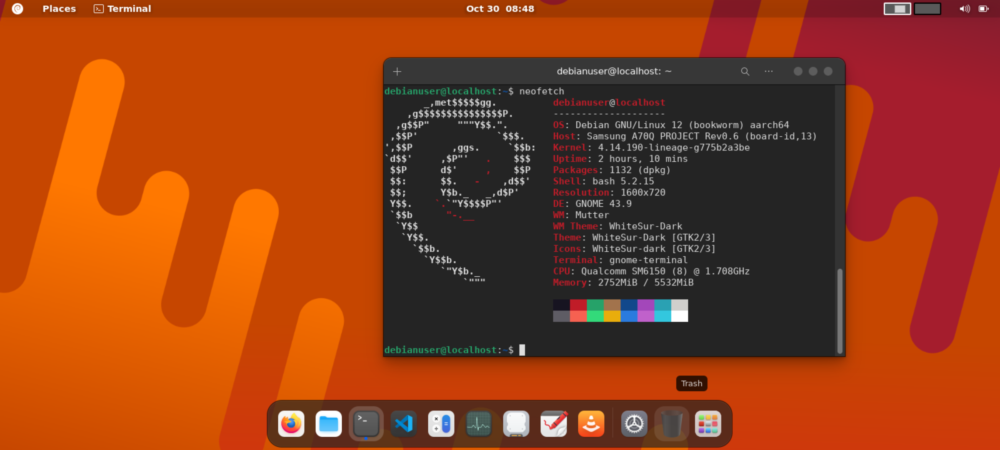
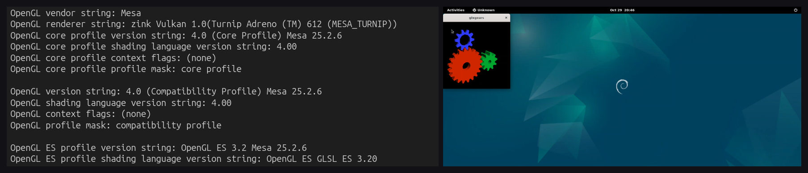
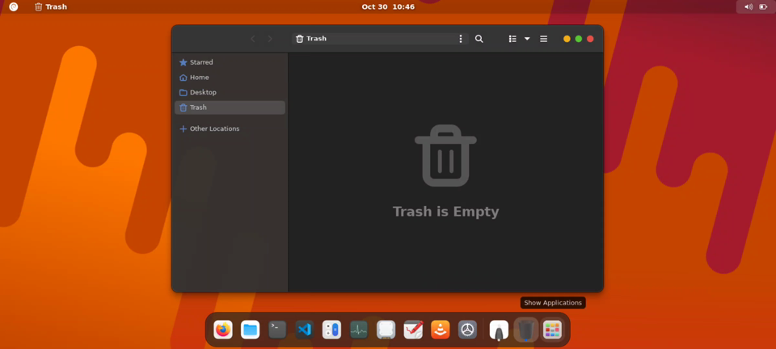
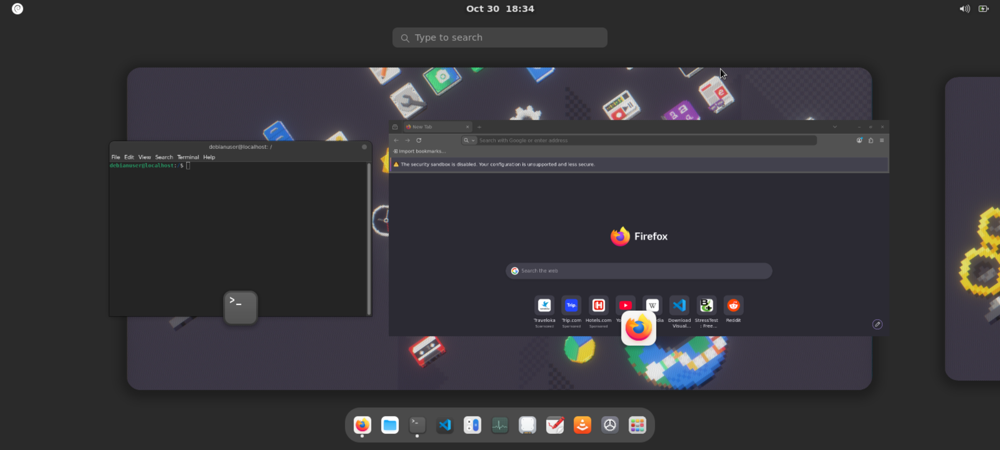

# Adrenux: Snapdragon Adreno Linux GPU Acceleration (Turnip KGSL + Mesa Zink)

Panduan dan kumpulan skrip untuk menjalankan **Debian Chroot (ARM64)** di Android dengan **akselerasi GPU hardware (Vulkan + OpenGL)** menggunakan driver open-source Mesa (**Turnip KGSL** dan **Zink**) melalui tampilan **Termux:X11**.

---

## Hasil Pengujian & Screenshot

Berikut adalah tangkapan layar langsung dari pengujian di perangkat:

### 1. Boot Debian 12 & Info Sistem
Debian 12 (Bookworm) ARM64 berjalan dengan desktop environment GNOME Shell 43.9 dan window manager Mutter di atas kernel Android:



### 2. Verifikasi Driver GPU (glxinfo & glxgears)
Verifikasi langsung output terminal `glxinfo` yang mendeteksi renderer `zink Vulkan 1.0 (Turnip Adreno (TM) 612 (MESA_TURNIP))` beserta 3D rendering `glxgears`:



### 3. Tampilan Desktop GNOME & Aplikasi
Desktop environment GNOME Shell 43 dan aplikasi browser (Firefox) berjalan langsung di dalam chroot:

| Tampilan Desktop GNOME 43 | Browser Firefox Berjalan di Debian |
| :---: | :---: |
|  |  |

---

## Arsitektur

Secara default, instalasi Linux chroot di Android menggunakan CPU software rendering (`llvmpipe`), yang membebani CPU dan membuat antarmuka desktop terasa berat. Project ini menghubungkan rendering langsung ke GPU Adreno melalui alur berikut:

```text
+--------------------------------------------------------+
| Desktop Environment / Aplikasi (GNOME 43, XFCE4, dll)  |
+---------------------------+----------------------------+
                            | (Panggilan OpenGL)
                            v
+--------------------------------------------------------+
| Mesa Zink (Driver Gallium OpenGL di atas Vulkan)       |
| Konfigurasi: GALLIUM_THREAD=0, LIBGL_KOPPER_DRI2=1     |
+---------------------------+----------------------------+
                            | (Panggilan Vulkan)
                            v
+--------------------------------------------------------+
| Mesa Turnip (Driver Vulkan Freedreno)                  |
| Backend KMD: Kernel Graphics Support Layer (KGSL)      |
+---------------------------+----------------------------+
                            | (Ioctl kernel)
                            v
+--------------------------------------------------------+
| Node Kernel Android: /dev/kgsl-3d0                     |
+---------------------------+----------------------------+
                            | (Hardware GPU)
                            v
+--------------------------------------------------------+
| GPU Qualcomm Adreno (Seri 600 / 700)                   |
+--------------------------------------------------------+
```

---

## Status Kompatibilitas Hardware

Driver Mesa Turnip dalam project ini dikompilasi dengan backend **KGSL** (`-Dfreedreno-kmds=kgsl`), yaitu interface driver kernel GPU Qualcomm yang ada di hampir semua kernel Android Snapdragon.

> [!NOTE]
> **Catatan Kejujuran Kompatibilitas:**
> Sejauh ini, konfigurasi ini **baru diuji dan dipastikan berfungsi pada Adreno 612 (Snapdragon 675)**.
> Chipset lain yang tercantum di bawah secara arsitektur memiliki interface KGSL yang serupa dan kemungkinan besar bisa berjalan, namun **belum pernah diuji secara langsung** pada project ini. Jangan berasumsi langsung berjalan tanpa penyesuaian.

### Tabel Chipset & GPU

| GPU Family | Model Adreno | Contoh SoC Snapdragon | Status Pengujian | Keterangan |
| :--- | :--- | :--- | :--- | :--- |
| **Adreno 600 Series** | **Adreno 612** | Snapdragon 675 (SM6150) | **Sudah Dites & Berfungsi** | Berhasil menjalankan vkcube, glxgears, dan GNOME 43 |
| | **Adreno 610** | Snapdragon 665, 662, 460 | Belum Dites | Arsitektur KGSL sama, kemungkinan bisa |
| | **Adreno 615 / 616** | Snapdragon 670, 710, 712 | Belum Dites | Arsitektur KGSL sama, kemungkinan bisa |
| | **Adreno 618** | Snapdragon 720G, 730, 730G, 732G | Belum Dites | Arsitektur KGSL sama, kemungkinan bisa |
| | **Adreno 619** | Snapdragon 750G, 690, 695, 480 | Belum Dites | Arsitektur KGSL sama, kemungkinan bisa |
| | **Adreno 620** | Snapdragon 765, 765G, 768G | Belum Dites | Arsitektur KGSL sama, kemungkinan bisa |
| | **Adreno 630** | Snapdragon 845 | Belum Dites | Target Turnip lama yang sudah matang di upstream |
| | **Adreno 640** | Snapdragon 855, 855+ | Belum Dites | Arsitektur KGSL sama, kemungkinan bisa |
| | **Adreno 642L / 643** | Snapdragon 778G, 778G+, 782G | Belum Dites | Arsitektur KGSL sama, kemungkinan bisa |
| | **Adreno 650** | Snapdragon 865, 865+, 870 | Belum Dites | Arsitektur KGSL sama, kemungkinan bisa |
| | **Adreno 660** | Snapdragon 888, 888+ | Belum Dites | Arsitektur KGSL sama, kemungkinan bisa |
| **Adreno 700 Series** | **Adreno 730** | Snapdragon 8 Gen 1 | Belum Dites | Butuh dukungan Mesa 24.x/25.x |
| | **Adreno 740** | Snapdragon 8 Gen 2 | Belum Dites | Butuh dukungan Mesa 24.x/25.x |
| | **Adreno 750** | Snapdragon 8 Gen 3 | Belum Dites | Butuh dukungan Mesa 24.x/25.x |

> [!WARNING]
> **Perangkat yang Tidak Didukung:** MediaTek (GPU Mali / Immortalis) dan Samsung Exynos (GPU Mali / Xclipse AMD) **tidak kompatibel** karena tidak menggunakan kernel driver Qualcomm KGSL. GPU Adreno seri lama (Adreno 5xx ke bawah) belum mendukung Vulkan 1.3 secara penuh.

### Ekspektasi Realistis & Batasan Teknis
- **Bukan Pengganti PC Desktop:** Setup ini ditujukan untuk eksperimen atau utilitas desktop portabel. Performa sangat bergantung pada thermal throttling smartphone Anda saat beban kerja lama.
- **Rendering Artifacts & Glitches:** Beberapa aplikasi dengan shader OpenGL yang sangat kompleks mungkin menampilkan visual glitch karena translasi Zink ke Vulkan Turnip.
- **Batasan Lingkungan Chroot:** Layanan sistem seperti GNOME Screencast, PolicyKit/PolKit penuh, dan UPower berjalan dengan batasan karena chroot berbagi kernel dengan Android.

### Kebutuhan Perangkat & Software
- **Akses Root:** Magisk, KernelSU, atau APatch (dibutuhkan untuk chroot mounting dan izin akses ke `/dev/kgsl-3d0`).
- **Versi Kernel:** Linux 4.9, 4.14, 4.19, 5.4, 5.10, atau 5.15+ dengan modul KGSL aktif.
- **OS Android:** Android 9 hingga Android 14/15.
- **Termux & Termux:X11:** Versi rilis GitHub terbaru.
- **Distro Linux:** Debian 12 (Bookworm) arm64 via `chroot-distro`.

---

## Langkah Instalasi

Semua skrip otomasi berada langsung di root direktori project ini.

### 1. Siapkan Termux dan Debian Chroot
Jalankan di Termux (user biasa):
```bash
pkg update && pkg install -y tsu chroot-distro pulseaudio
chroot-distro install debian
```

### 2. Mount Filesystem Chroot
Jalankan skrip `mount-chroot.sh` sebagai root di Android (`su`):
```bash
su
sh mount-chroot.sh
```
Skrip ini akan melakukan bind-mount untuk `/dev`, `/dev/pts`, `/dev/shm`, `/proc`, `/sys`, memberikan izin `666` pada `/dev/kgsl-3d0`, serta menghubungkan socket X11 dari Termux.

### 3. Kompilasi Driver Mesa Turnip & Zink

Masuk ke dalam chroot Debian (`chroot-distro login debian`):

#### A. Kompilasi Turnip Vulkan (KGSL Backend)
```bash
bash build-mesa-turnip.sh
```
*Flag Meson yang digunakan:*
```bash
meson setup build-turnip mesa-25.2.6 \
  --prefix=/opt/mesa-kgsl --libdir=lib --buildtype=release \
  -Dgallium-drivers= \
  -Dvulkan-drivers=freedreno \
  -Dfreedreno-kmds=kgsl \
  -Dplatforms=x11 \
  -Degl=disabled -Dglx=disabled -Dgbm=disabled \
  -Dllvm=disabled -Dbuild-tests=false
```

#### B. Kompilasi Zink (OpenGL over Vulkan)
```bash
bash build-mesa-zink.sh
```
> [!IMPORTANT]
> **Catatan Penting Flag `-Dgbm=enabled`:**
> Pada Mesa 25.x, kompilasi GLX DRI tanpa opsi `-Dgbm=enabled` akan menyebabkan Meson melewatkan target `subdir('gallium/targets/dril')`, sehingga library `zink_dri.so` tidak akan terbuat. Flag `-Dgbm=enabled` wajib disertakan.

*Flag Meson yang digunakan:*
```bash
meson setup build-zink mesa-25.2.6 \
  --prefix=/opt/mesa-zink --libdir=lib --buildtype=release \
  -Dgallium-drivers=zink \
  -Dvulkan-drivers= \
  -Dplatforms=x11 -Dglx=dri -Degl=enabled -Dgles2=enabled \
  -Dgbm=enabled -Dllvm=disabled -Dbuild-tests=false
```

#### C. Verifikasi File Hasil Kompilasi
Jalankan skrip verifikasi untuk memastikan header ELF AArch64 dan dependensi dinamis sudah lengkap:
```bash
bash verify-build.sh
```

---

## Menjalankan Desktop Berakselerasi GPU

### 1. Buka Display Termux:X11
Di sesi Termux Android:
```bash
termux-x11 :2 &
am start -n com.termux.x11/com.termux.x11.MainActivity
```

### 2. Mulai Desktop di Dalam Chroot
Di dalam Debian chroot:
```bash
# Menjalankan GNOME Shell 43
bash start-desktop.sh gnome

# Atau menjalankan XFCE4
bash start-desktop.sh xfce
```

### Environment Variable Penting untuk Stabilitas:
```bash
export VK_ICD_FILENAMES=/opt/mesa-kgsl/share/vulkan/icd.d/turnip_icd.json
export LD_LIBRARY_PATH=/opt/mesa-zink/lib:$LD_LIBRARY_PATH
export LIBGL_DRIVERS_PATH=/opt/mesa-zink/lib/dri
export MESA_LOADER_DRIVER_OVERRIDE=zink
export GALLIUM_DRIVER=zink

# PENCEGAHAN CRASH MUTTER / GNOME SHELL:
# Mengatasi race condition pada multithreaded queue tu_CmdPipelineBarrier2
export GALLIUM_THREAD=0
export LIBGL_KOPPER_DRI2=1
export GSK_RENDERER=cairo
export GTK_A11Y=none
export NO_AT_BRIDGE=1
```

---

## Verifikasi & Diagnostik

Untuk memeriksa apakah akselerasi GPU benar-benar aktif (bukan software llvmpipe), jalankan:
```bash
bash test-gpu.sh
```

### Hasil yang Diharapkan:

1. **Pemeriksaan Vulkan (`vulkaninfo`):**
   ```text
   deviceName     = Turnip Adreno (TM) 612
   driverName     = freedreno
   apiVersion     = 1.3.318
   ```

2. **Render Vulkan (`vkcube`):**
   ```text
   Selected GPU 0: Turnip Adreno (TM) 612, type: IntegratedGpu
   FRAME_TEST_EXIT=0 (120 frames selesai dirender)
   ```

3. **Pemeriksaan OpenGL Zink (`glxinfo -B`):**
   ```text
   OpenGL vendor string: Mesa
   OpenGL renderer string: zink Vulkan 1.0(Turnip Adreno (TM) 612 (MESA_TURNIP))
   OpenGL core profile version string: 4.0 (Core Profile) Mesa 25.2.6
   OpenGL ES profile version string: OpenGL ES 3.2 Mesa 25.2.6
   Accelerated: yes
   ```

4. **Pengujian Framerate OpenGL (`glxgears`):**
   ```text
   Running synchronized to the vertical refresh.
   432 frames in 5.0 seconds = 86.400 FPS (Terkunci VSync)
   ```

---

## Optimasi Hardware (`tune-hardware.sh`)

Untuk membantu mengurangi hambatan I/O dan frekuensi CPU, skrip `tune-hardware.sh` dapat dijalankan sebagai root di Android:
- **CPU:** Menyalakan seluruh core CPU dan mengatur governor cpufreq ke `schedutil` dengan base frequency yang stabil.
- **GPU:** Mengatur clock rate devfreq GPU Adreno ke level maksimum yang diizinkan kernel tanpa memicu hang SurfaceFlinger.
- **Storage:** Mengatur antrian I/O storage UFS ke scheduler `deadline` dan `read_ahead_kb=2048`.
- **IPC Socket:** Memperbesar buffer socket (`net.core.wmem_default=8388608`) untuk mencegah delay komunikasi X11.

---

## Lisensi
MIT License. Bebas digunakan dan dikembangkan kembali.
